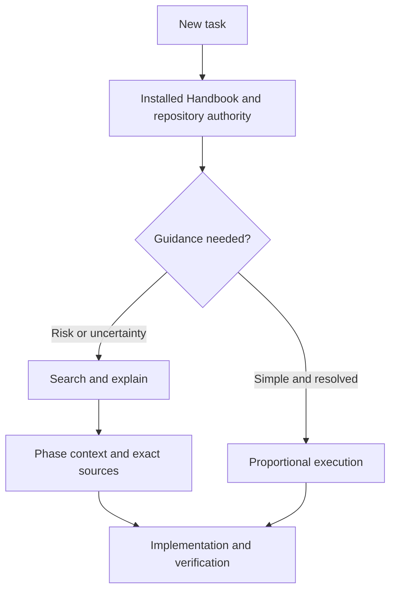

# MelodIQ Mindset

**MelodIQ Mindset** is the shared knowledge and operating model of MelodIQ Systems. This repository contains its canonical, cross-repository engineering layer, historically named the Engineering Handbook. Business decisions and private live records remain with their authorized owners; the public engineering repository does not contain private client, CRM, contract, financial or employee records.

## Identity and compatibility

- The visible name is MelodIQ Mindset. Keep the existing `engineering-handbook` repository slug, managed skill name, artifact IDs, bootstrap paths, Python module, schemas and historical ADRs until the corresponding migration is independently verified. These are compatibility identifiers, not a second source of policy.
- ChatGPT may consume the same canonical engineering sources through a private knowledge-routing plugin; Codex uses the managed local router and verified snapshot. Business routing is a complement, not an alternative engineering authority. Do not load every domain or maintain separate copies of engineering policies.
- A future repository-slug move to `Kappa-Bot/melodiq-mindset` must preserve the same repository identity and Git history. Before the move, inspect exact-origin allowlists, manifest verification, bootstrap and installer compatibility, all consumer references, CI/provider integrations and release receipts. Validate old and new locators without assuming redirects satisfy exact checks. Preserve the original commit IDs and existing installed snapshots; never bulk-rewrite history or silently modify unrelated repositories.
- All installs, migrations and refreshes remain explicitly manual and reversible. No startup hooks, polling, automatic update gate, new paid service or consumer deployment follows from this naming change.
- The canonical catalog and compiled discovery must be regenerated and verified together before merging a source change; a name or branch change is not evidence of completed installation, migration or audit.

Its purpose is to turn engineering learning into a governed system that can be discovered, challenged, promoted, applied, verified, versioned and retired without repeatedly reinventing the same decisions.

## Mission

Make strong engineering the default across repositories while keeping permanent agent context small and product-specific freedom high.

## Start here

| Question | Entry point |
| --- | --- |
| Which guidance applies, and why? | [Discovery and update](playbooks/handbook-discovery-and-update.md): `search`, `tree`, `explain`, `doctor` |
| Which model/effort and invocation? | [Runtime Standard](standards/agent-runtime-routing.md) and [invocation playbook](playbooks/agent-runtime-routing.md) |
| How do I update the Handbook when needed? | [Manual installation and updates](playbooks/handbook-discovery-and-update.md#manual-only-local-handbook-installation) |
| How do I find or remove blocking Handbook hooks across coding agents? | [Cross-agent isolation and offline inventory](references/code-agent-hook-isolation.md) |
| How should I write, name, organize or refactor code? | [Code quality Standard](standards/code-quality-organization-baseline.md) and [code change playbook](playbooks/code-change-workflow.md) |
| How do I choose or replace a library? | [Dependency/supply-chain Standard](standards/dependency-supply-chain-baseline.md) and [external solution evaluation](playbooks/external-solution-evaluation.md) |
| How do I audit the product's UX, UI, performance, security and privacy together? | [Engineering Quality Audit](playbooks/engineering-quality-audit.md) and [risk-based verification matrix](patterns/risk-based-verification-matrix.md) |
| Where are specialized UX/accessibility and performance reviews? | [Frontend Quality Review](playbooks/frontend-quality-review.md), [UI Standard](standards/ui-ux-quality-baseline.md), [Performance Budgeting](patterns/performance-budgeting.md) |
| Where are security, privacy and runtime reviews? | [Security Review](playbooks/security-review.md), [Privacy/Data Handling](standards/privacy-data-handling-baseline.md), [Production Operability](standards/production-operability-baseline.md) |
| Where does a rule live? | [Catalog](machine-readable/catalog.yaml), [topic aliases](machine-readable/discovery/taxonomy.v1.json) and the knowledge tree |
| How do I change the Handbook safely? | [Contribution guide](CONTRIBUTING.md), regression tests, compile/check/integrity commands below |



The compiled corpus is a generated projection for routing and planning efficiency. It is **not** a second source of truth: canonical Markdown and permitted repo-local decisions retain authority.

## Core principles

- **Reuse first. Search before build.**
- **Canonical baseline, not ceiling.** Mature products can discover stronger practice; validate and promote it upward.
- **Truthful engineering.** Never simulate confidence or production capability that does not exist.
- **Single source of truth.** One active canonical normative artifact per topic.
- **Evidence before claims.** A gate passed only if it was actually executed and observed.
- **Production-minded, not speculative.** Complexity requires a current reason.
- **No silent scope creep.** Keep changes narrow and reviewable.
- **No documentation cemetery.** Create categories only when a real artifact exists.
- **Automate stable rules, not opinions.** Enforcement follows demonstrated value.
- **Repo-local identity stays local.** Brand, product workflow and domain decisions are not homogenized by the handbook.
- **Unused context budget is a feature.** Do not load guidance merely because token capacity remains.

### Codex subagents and November 2026 model routing

[ADR 0011](decisions/0011-quality-first-codex-subagent-routing.md), amended by [ADR 0012](decisions/0012-handbook-discovery-and-safe-preflight-update.md), replaces the October low-effort bias. Substantive engineering starts around Sol 6.2/high, difficult integration around Sol/xhigh, high-impact architecture/security around Astra 6.2/high–xhigh, and bounded verified/visual work around Terra 6.1/high. **GPT-6 Luna is prohibited in active routing and fallbacks.** Dynamic Agency Agents specialization, the ordinary zero-spawn baseline and normal two-worker cap remain; actual higher-priority instructions and task authority govern delegation. Resolve every model/effort against the real client/account/spawn allowlist. The [runtime Standard](standards/agent-runtime-routing.md), [invocation playbook](playbooks/agent-runtime-routing.md) and [Codex adoption guide](playbooks/codex-global-adoption.md) define custom-agent TOML precedence and verified adoption.

More reasoning tokens are authorized **within existing included usage**, not extra monetary charges, paid tiers or GitHub Actions. Publication here does not itself change a Windows `config.toml`, installed skill bundle or active Codex session.

### Writing, cleaning and structuring code

The [Code Quality, Naming and Repository Organization Standard](standards/code-quality-organization-baseline.md) owns cross-repository code craft: meaningful names and units, module cohesion, dependency direction, explicit errors/side effects, safe renaming and folder moves, and evidence-based simplification. The focused [Code Change and Maintenance Workflow](playbooks/code-change-workflow.md) routes the actual task from local entrypoint and consumer tracing through implementation, dependency decisions, risk-specific checks and handoff. These extend the existing [Engineering Change](playbooks/engineering-change.md) lifecycle; they do not mandate a global `src/` tree, case style, package manager, library or LOC cap.

Codex now distinguishes code authoring, code organization and library selection in English and Spanish, with typed paths for source files, tests and dependency manifests. Choosing a library is **not** authorization to install it; a code review is **not** authorization to edit. The router excludes negated edits, documentation/code samples and vendor/generated paths where identifiable. When classification or local landmarks are unresolved, inspect the actual repository. No product code is automatically restructured by this Handbook update.

### Cross-domain UX, UI, performance, security and privacy reviews

The [Engineering Quality Audit](playbooks/engineering-quality-audit.md) is the focused orchestration entrypoint for a full product/repository audit. It asks which user journeys, threats, privacy/data flows and runtime boundaries are actually at risk, then loads the appropriate owners: [UI/UX](standards/ui-ux-quality-baseline.md), [Frontend Review](playbooks/frontend-quality-review.md), [Performance Budgeting](patterns/performance-budgeting.md), [Security Review](playbooks/security-review.md), [Privacy/Data Handling](standards/privacy-data-handling-baseline.md), [Data Integrity](standards/architecture-data-integrity-baseline.md) and [Release/Operability](playbooks/quality-release-review.md). Spanish public client websites additionally use their [existing legal/trust owner](standards/public-website-legal-trust-baseline.md).

Versioned ES/EN triggers distinguish holistic versus targeted reviews and route to real UI interaction tests, security configuration, data retention, performance evidence and observability paths. The knowledge tree separates UX/UI, performance, privacy, security and reliability topics. The compiler selects phase-specific safeguards; an unresolved path or risk requires inspection, not an automatic PASS. **Review remains read-only**, including no implied Unslop redesign, deployment, load test, issue publication, migration, paid CI or provider changes. Relevant rendered, negative-path, measured and remote evidence must be actually observed; missing gates remain explicit.

## Deterministic agent context

Key canonical pages may contain a fenced `json agent-context` block that projects only the smallest planning/implementation/verification units needed by agents. Those blocks must express meaning already supported by the page; they cannot create or strengthen authority.

`automation/engineering_context` compiles those projections and the **complete catalog** into `machine-readable/compiled/`. The discovery registries own generic triggers, ES/EN aliases, typed links, inspection order and repository landmarks; complex visual recognizers remain named/tested language features. The runtime provides deterministic profiling, task evidence, detected-risk coverage, Planning IR, full-text search, knowledge/execution/repository trees and explanations. Catalog pages without context blocks are still searchable.

Useful commands:

```text
python -m automation.engineering_context check --root .
python -m automation.engineering_context integrity --root .
python -m automation.engineering_context doctor --root .
python -m automation.engineering_context search --root . --query "invocación subagentes" --pretty
python -m automation.engineering_context tree --root . --kind knowledge --pretty
python -m automation.engineering_context explain --root . --repo <repo> --task "<task>" --pretty
python -m automation.engineering_context profile-repo --repo <repo>
python -m automation.engineering_context context --repo <repo> --handbook machine-readable/compiled --mode plan --task "<task>" --metrics
```

The `context` command returns a compact task descriptor, repo route, phase-specific capsule and Planning IR seed. If a required risk is uncovered or bounded uncertainty remains material, the agent escalates to canonical guidance rather than fabricating certainty.

`profile-repo` derives `detected.package_manager` from the first recognized
root lockfile in its fixed order. With both `pnpm-lock.yaml` and `yarn.lock`,
it reports `pnpm` even if `package.json` declares Yarn. With no recognized
root lockfile, it reports `null`. When choosing a command during a migration,
check the repository's `packageManager` declaration and contributor
instructions. Verify the installed tool separately when availability matters.

The `profile-repo --output` command recomputes current segment fingerprints.
When it can compare a segment with the prior `repo.json`,
`meta.reused_segments` lists its name on a match. The fingerprint values are
in `meta.segment_hashes`.
The `context --metrics` command starts with a new profile, so its
`repo_profile_segment_reuse` count is zero. Use observed timings or file
reads to quantify work saved.

Budgets now adapt to risk and uncertainty (up to a 6,500-token advisory hard estimate for complex cases); mandatory requirements are retained with explicit escalation even beyond that estimate. Small representative cases still remain below 600 tokens. Unresolved paths, unknown classification and empty detected-risk coverage are **not** a safety PASS. Static estimates are neither provider-measured token usage nor evidence of cost savings.

### Manual-only Codex Handbook updates

**No automatic update or preflight hooks are installed in any supported coding-agent client.** Codex, Claude Code, Cursor, Gemini CLI, Copilot/VS Code, Windsurf, Cline, OpenCode and other agents should start tasks without consulting GitHub or blocking messages on the Handbook's behalf. The [offline inventory tool](automation/agents/handbook_hook_audit.py) detects legacy owned hooks in known settings and only removes exact owned user entries on explicit request; external/managed hooks remain the client's responsibility. From a trusted checkout, run `python automation/codex/handbook_update.py install` only when an explicit update is required (`--backup-existing` retains an unmanaged older skill). The installer removes legacy Handbook-owned `SessionStart` and `UserPromptSubmit` hooks without touching unrelated hooks. Use `doctor` for local integrity and `preflight` for an explicit remote check. The [manual update playbook](playbooks/handbook-discovery-and-update.md) documents verified fast-forward, drift protection, recoverable activation and offline rescue. No consumer checkout or chat history is reset, and publishing a Handbook commit does not automatically change an existing Windows installation.

### Selective ECC adoption

The original **Affaan Mustafa / ECC** is a pinned workflow reference, not a replacement Handbook or a blanket plugin installation. See [the adoption assessment](references/ecc-adoption-assessment.md) for the capability-by-capability comparison and [ADR 0007](decisions/0007-selective-ecc-handbook-adoption.md) for the decision and rollout boundary.

Useful deltas live in the existing canonical owners: verification/release evidence, safe browser QA and comparable visual baselines, agent-tool supply-chain review, supervised knowledge promotion, and controlled agent-workflow evaluation. Agency Agents remains the specialist catalog; the single generic router, explicit runtime/cost policy and product-owned design decisions remain intact.

Changes to agent configurations/plugins/hooks/MCP route a compact execution-boundary check; learning/memory work routes a reviewed-promotion check. Ordinary React hooks, webhooks, server memory defects and documentation typos do not pull in this guidance merely through ambiguous keywords. No observer, scheduled model call, MCP server or native plugin is installed by consuming the documentation. Existing consumers require their normal authorized bundle refresh before the new source is effective.

### Selective Marketing Skills adoption

The pinned [Marketing Skills assessment](references/marketing-skills-adoption-assessment.md) and [ADR 0008](decisions/0008-selective-marketing-skills-adoption.md) adopt twelve prioritized workflows as original, scoped Handbook procedures, not twelve competing skills or a plugin installation:

- [Marketing context and content](playbooks/marketing-context-and-content.md): audience, offer, proof, voice, CRO, competitor evidence and sales collateral; reuse the local brief, optionally seeded by [the context template](templates/product-marketing-context.md).
- [Lead qualification and handoff](playbooks/lead-qualification-and-handoff.md): sourced fit/priority, existing CRM ownership/stages, and a separate Spain/EU channel-permission gate.
- [Conversion measurement and experiments](playbooks/conversion-measurement-and-experiments.md): confirmed outcomes, consent/data minimization, deduplication, destination evidence and honest low-traffic decisions.

SEO, AI-search observations, site architecture, design and website delivery remain with their existing canonical owners. The single router selects compact context for the actual task; currency conversion, database schema, code review and private-console glass work do not become marketing tasks. Product facts and private business records stay local. No campaign, sending, paid tool, account, schedule or consumer installation follows from source publication; existing consumers use their normal authorized bundle refresh.

### Unslop design reconstruction

The [Unslop adoption assessment](references/unslop-adoption-assessment.md) and [ADR 0009](decisions/0009-unslop-design-reconstruction.md) establish an active, aggressive design method, not a reference-only pilot or a second skill. Material UI work uses the existing [UI Standard](standards/ui-ux-quality-baseline.md), [Design Context Layering](patterns/design-context-layering.md) and [Frontend Quality Review](playbooks/frontend-quality-review.md): rendered diagnosis, five-line product direction, nine-pass dispositions and real critical-journey acceptance.

Within an authorized redesign, replace weak composition, hierarchy, copy, palette, typography, components and motion rather than protecting them because they were previously approved. Supersede affected local design decisions explicitly. The [MelodIQ visual-direction catalog](patterns/visual-direction-catalog.md) makes Glassmorphism a **scoped starting default for new/authorized material design of internal consoles without an applicable local choice**, with selectable Neumorphism and solid/editorial alternatives; compact rails and photographic heroes remain optional mechanics. Product truth, permissions, accessibility, privacy, performance and release gates remain intact; a narrow fix or audit does not authorize reconstruction.

The generic router recognizes English/Spanish Unslop and redesign requests, with negative coverage for reference research, backend work and micro-edits. The adaptation strengthens upstream verification and removes its preservation rules, stylistic bans and three-render ceiling. [Attribution and modifications](references/unslop-adoption-assessment.md#attribution-and-reuse) preserve the original CC BY 4.0 credit. A merged Handbook source still requires the normal authorized consumer refresh; it does not redesign or deploy applications automatically.

### Modern Web Guidance and Ponytail

[ADR 0010](decisions/0010-modern-web-lean-engineering-adoption.md) makes both methods active through existing canonical owners, with [pinned sources, licenses, adaptations and execution/privacy review](references/modern-web-ponytail-adoption-assessment.md):

- [Reuse First](policies/reuse-first.md#minimum-complete-change): trace the owning flow and direct/indirect consumers; choose the smallest complete solution, not the shortest diff. Preserve requested scope, safety/data contracts and authorized Unslop reconstruction; no line quota, debt immunity or one-test ceiling.
- [Modern Web Platform Workflow](playbooks/modern-web-platform-workflow.md): current native HTML/CSS/browser guidance, exact pinned guide locators and the full upstream catalog, product-specific support/fallbacks, framework ownership and real verification. Applies to material browser work, not SQL/backend work or copy edits.
- [Connected-product resource map](references/connected-product-resource-map.md): the existing owners for custom product agents, internal CRM/API and public websites, including the typical React/Next, Vercel, Supabase/PostgreSQL and Playwright context without imposing a shared architecture or provider.

The single Codex router and installed bundle expose these resources in English/Spanish task routing. **No third-party skill/plugin, hooks, telemetry, npm runtime, experimental opt-in or new scheduler is activated.** Modern Web Guidance logs search text by default; Ponytail's inspected Codex path has three hook events. The adoption keeps the useful engineering methods without silently importing that executable behavior. Source merge still requires the normal authorized consumer refresh and verification; it does not update a workstation or deploy applications.

## Taxonomy and precedence

| Kind | Purpose | Normative? |
|---|---|---|
| Governance | authority, precedence, lifecycle, promotion | yes |
| Policy | mandatory cross-repository behavior | yes |
| Standard | technical baseline for a defined scope | yes |
| Pattern | reusable solution | no unless referenced normatively |
| Playbook | repeatable procedure | no unless referenced normatively |
| Reference | evidence/research | no |
| Template | reusable starting artifact | only when explicitly required |
| Executable asset | script/rule/hook/CI/gate/skill | enforces or assists stable rules |
| Decision | durable historical choice | records rationale/authority |

Precedence:

```text
external non-negotiable obligation
→ Handbook Governance
→ active Policy
→ active Standard
→ permitted repo-local decision/exception
→ Pattern
→ Playbook
→ Reference/research
```

## Engineering baselines

### Architecture, data and capability truth

Use:

- `policies/truthful-engineering.md`;
- `standards/architecture-data-integrity-baseline.md`;
- `patterns/source-of-truth-boundaries.md`;
- `patterns/capability-environment-integrity.md`;
- `playbooks/architecture-data-review.md`.

Key ideas: name authoritative owners, keep domain invariants out of incidental UI state, protect history/integrity, treat migrations as production state changes, and do not extract generic cores before real consumers validate the abstraction.

### Security and identity

Use:

- `standards/security-identity-baseline.md`;
- `patterns/authorization-privileged-boundaries.md`;
- `patterns/token-secret-link-handling.md`;
- `playbooks/security-review.md`.

Authentication and authorization are separate. Protected operations validate permissions at a server/data boundary. Privileged credentials stay out of client code. Bearer links/tokens are credentials. OWASP ASVS is used proportionally as a verification catalog.

### Testing, CI/CD and release integrity

Use:

- `standards/testing-release-quality-baseline.md`;
- `patterns/risk-based-verification-matrix.md`;
- `patterns/release-provenance-environment-gates.md`;
- `playbooks/quality-release-review.md`.

Test the failure class, not the fashionable tool. A green CI run proves only its configured gates. Build, deployment, migrations, post-deploy smoke and native/manual checks remain distinct evidence states.

### Production operability

Use:

- `standards/production-operability-baseline.md`;
- `patterns/observability-signals.md`;
- `playbooks/production-readiness-review.md`.

Choose logs, metrics, traces, synthetics and domain health because they answer operational questions. OpenTelemetry is optional; if used, prefer relevant stable semantic conventions. Do not create decorative dashboards or report unknown data as zero.

### Dependencies and supply chain

Use `standards/dependency-supply-chain-baseline.md`.

Lock dependency resolution where the ecosystem supports it, evaluate meaningful dependencies, keep privileged CI least-privileged, and prefer immutable full-SHA references for third-party GitHub Actions. OpenSSF Scorecard is a signal, not a magic threshold. SBOMs, signing and attestations are risk/distribution-driven rather than universal ceremony.

### APIs and integration contracts

Use `patterns/api-contract-evolution.md` when independent consumers make interface drift expensive. OpenAPI is the preferred formal description for HTTP APIs when a formal contract is warranted; it is not required for every internal route.

### Performance

Use `patterns/performance-budgeting.md`.

Measure representative user/product constraints and define repo-specific budgets only where repeated regression risk justifies them. Core Web Vitals are useful web signals, not the complete performance definition for every product.

### UI/UX and frontend quality

Use:

- `standards/ui-ux-quality-baseline.md`;
- `playbooks/frontend-quality-review.md`;
- `playbooks/public-client-website-delivery.md` for the complete public service/client-site flow: proposition, image prompts and desktop/mobile assets, hero, header CTAs, gallery, review truth modes, lead form and verified deployment;
- `standards/public-website-legal-trust-baseline.md` for public/client demos and launches: legally accountable identity, sector-specific health advertising, RGPD/cookies, third-party embeds, AI media disclosure, reviews and launch sign-off;
- `playbooks/spanish-client-website-privacy-consent-audit.md` for Spanish SME service sites with contact/quote forms and no checkout: actual controller/vendor roles, form notices, cookies/analytics, AI and technical/owner gates; use `templates/spanish-client-website-legal-evidence-pack.md` per client and `references/spain-sme-lead-web-legal-research-2026-11.md` for sourced legal distinctions and evidence limits;
- `patterns/mobile-responsive-interaction.md` when physical mobile constraints matter;
- `patterns/operator-console-shell-interactions.md` for reusable theme, sidebar and route-continuity mechanics in authenticated MelodIQ operator consoles;
- `patterns/visual-direction-catalog.md` for product-level visual material selection (internal-console Glassmorphism starting default, explicit Neumorphism or solid/editorial options); `patterns/operator-glass-surface-material.md` and `patterns/operator-neumorphic-surface-material.md` for material-specific acceptance;
- `patterns/public-marketing-hero-motion.md` for public/client site first-viewport composition, image/CTA hierarchy and optional Tommy Jepsen-style rotating-word hero motion;
- `patterns/public-service-gallery-selector.md` for @minhxthanh-inspired expanding service-photo panels, mobile scroll-snap, keyboard selection and truthful image provenance;
- `patterns/public-client-reviews-marquee.md` for the approved Google-inspired, demo-safe testimonials marquee (two-row or single-row), source attribution, pause/motion and adoption checks;
- `patterns/visual-evidence-integrity.md` when rendered evidence supports acceptance.

The handbook does **not** prescribe a component library, dashboard grammar, palette, radius, CSS framework or universal art direction. The sole portfolio **material starting default is scoped to new/authorized internal consoles** and never overrides current product `DESIGN.md` or implies retroactive UI changes. It does require the integrated Unslop reconstruction/review method for material design work. Quality is the floor; product character is repo-local, and existing visual decisions must earn retention through current evidence rather than historical approval alone.

To inspect available directions and precedence without changing any product: `python -m automation.engineering_context visual-directions --root .` (catalog) or `python -m automation.engineering_context visual-directions --root . --surface internal-console --local-style neumorphism` (selection). Future per-user runtime style switching is intentionally deferred.

### Public search presence, SEO and brand

For corporate marketing, public vertical product landings and client/lead websites, use:

- `standards/public-web-discoverability-baseline.md` for indexation, crawl/metadata, truthful entity signals and Agent Discoverability (HTTP Link, negotiated Markdown, conditional DNS-AID);
- `playbooks/public-web-discoverability-launch.md` for an executable per-site audit → identity/visual direction → implementation → release → Search Console monitoring workflow.

A private CRM, demo or prelaunch page does **not** become indexable merely because public SEO is desirable. Domain, legal identity, brand, client facts, launch gate, screenshots and art direction stay with the owning repository; the handbook provides a common quality floor, not identical websites or guaranteed Google rankings.

### Organic search delivery as a service

For MelodIQ Systems' **cross-sector Spanish SME SEO/AEO/GEO/LLMO delivery**, use [the organic search service operating system](playbooks/search-visibility-service-operations.md) alongside the existing canonical [public discoverability Standard](standards/public-web-discoverability-baseline.md) and [technical launch playbook](playbooks/public-web-discoverability-launch.md). It covers discovery, risk/permissions, audit, commercial search intent, local profiles, content, AI-answer sampling, QA, publication, reporting and handoff without duplicating technical authority.

Reusable, **client-workspace-only** templates: [delivery workbook](templates/search-visibility-client-workbook.md), [commercial proposal](templates/search-visibility-commercial-offer.md), and [monthly report](templates/search-visibility-monthly-report.md). The [research and myth corrections](references/search-visibility-research-2026-11.md) and [Spain pricing evidence](references/search-visibility-pricing-spain-2026-11.md) are **non-normative**: published agency prices are not approved MelodIQ tariffs, and AI visibility is not a guaranteed search outcome. No client credentials, domain changes, paid tools, analytics, account creation or publication are authorized by reading these documents.

### PWA

Use `standards/web-pwa-baseline.md`. PWA is capability-driven and scoped to the surface that gains value. Service worker/offline/push are not mandatory badges.

## Donor evidence

Two references preserve the internal evidence that created the first product-quality baselines:

- `references/internal-ui-pwa-donor-audit.md`;
- `references/internal-engineering-donor-audit.md`.

They audit CCSE-AI-Coach, Aluminio Bartra, COGOP Barcelona Attendance and MovOps OS. Donor choices are evidence, not automatic norms: provider/product details are removed and relevant primary sources challenge the reusable principle before promotion.

## Default task flow

1. Read the consumer repo's applicable `AGENTS.md` and repo-local decisions.
2. Search the current repo.
3. For non-trivial cross-repository guidance, use the generic handbook router and its compiled context runtime when available.
4. Escalate from the compact capsule to canonical Markdown only when required risk, uncertainty or exact normative detail warrants it.
5. For transversal/quality-sensitive decisions, compare relevant mature internal donors when doing so may materially improve the result.
6. Evaluate external mature/primary solutions when needed.
7. Design new only when reuse/adaptation does not fit.
8. Verify the risks relevant to the changed scope and disclose meaningful unrun gates.

Use `playbooks/engineering-change.md` as the proportional workflow and `policies/reuse-first.md` for the search contract.

## Repositories and knowledge promotion

A repository-level `AGENTS.md` contains verified local facts: purpose, commands, architecture boundaries, product/domain decisions and local gates. It should not duplicate universal handbook prose.

Use `playbooks/repository-adoption.md` and `templates/AGENTS.repo.md`.

Validated repo learning may be promoted through `governance/knowledge-promotion.md`. The handbook is the current approved baseline, not proof that every existing implementation is weaker.

## Source, distribution and runtime

Keep three layers distinct:

```text
AUTHORITATIVE SOURCE
canonical handbook Markdown + permitted repo-local decisions
        ↓
GENERATED / INSTALLED ARTIFACTS
compiled corpus + Codex global config + generic skill bundle
        ↓
RUNTIME CONTEXT
repo profile + task descriptor + only selected phase capsule
```

`machine-readable/compiled/` is generated from explicit structured projections inside canonical pages. The generic skill distributes both this corpus and the small Python runtime, so a consumer repo can obtain task-specific context without bulk-reading handbook documents.

A compiled hash is useful provenance/invalidation data, not authority. If generated output and canonical Markdown conflict, canonical source wins and the generated artifact must be corrected.

## Codex adoption

Canonical global instructions: `agent-config/codex/AGENTS.global.md`.

Canonical generic handbook router: `agent-config/codex/skills/engineering-handbook/SKILL.md`.

Agency Agents is the default upstream specialist-persona catalog for Codex engineering work. The Handbook does **not** impose permanent `parent/design-quality/delivery` roles or model-by-job-title bindings. Runtime routing chooses tool vs direct execution vs specialist spawn, then selects model and reasoning effort independently from task uncertainty, impact, verification and context cost. See `standards/agent-runtime-routing.md` and `references/agency-agents-specialist-routing.md`.

There are **no domain-specific UI/security/architecture/etc. skills**. Engineering knowledge remains ordinary governed handbook artifacts; the single generic router uses the deterministic compiled runtime for the normal hot path and canonical pages for escalation.

Distribution scripts:

```powershell
pwsh -File .\automation\codex\sync-global-agents.ps1 -Mode Check
pwsh -File .\automation\codex\sync-handbook-skill.ps1 -Mode Check
```

Use the corresponding adoption playbooks/ADRs before installation changes.

## OpenDesign local design studio (optional)

For visual prototypes, corporate presentation templates and derivative design-system packages, use `pb-open-design-local-adoption`. The first offline corporate kit is at `brands/melodiq-systems/open-design/`, with a compatible 56-token design-system snapshot and an editable A4 commercial draft.

This is a **local-file pilot**: no restricted logos, provider credentials, paid media services, write-capable MCP or OpenDesign-launched Codex are installed or authorized by the Handbook. On Windows/WSL, OpenDesign's Codex launcher can request `danger-full-access`; do not treat its local workspace as a sandbox.

Product and tenant visual authority stays with each consumer repository. An OpenDesign prototype is not released product evidence.

## Handbook integrity

Run both context freshness and structural integrity checks:

```text
python -m automation.engineering_context check --root .
```

```powershell
pwsh -File .\automation\handbook\check-integrity.ps1
```

The Python check enforces deterministic compilation, byte stability and checked-in freshness. The PowerShell checker validates catalog IDs/paths, frontmatter/source references and skill bundle integrity. Neither replaces semantic review.

## External source baseline

Primary/official authority is preferred. Important current anchors include:

- NIST SP 800-218 / SSDF v1.1 as the final general SSDF baseline; SSDF v1.2 is tracked as draft until finalized;
- OWASP ASVS 5.0.0 plus applicable OWASP Cheat Sheets;
- W3C WCAG/APG and web platform specs;
- Git/GitHub official documentation;
- OpenTelemetry when telemetry standardization is needed;
- OpenAPI when an HTTP API contract warrants formalization;
- OpenSSF security guidance/Scorecard as supply-chain inputs.

All material sources live in `machine-readable/sources.yaml` and are subject to review dates/volatility.

## Repository map

```text
engineering-handbook/
├── README.md
├── AGENTS.md
├── CONTRIBUTING.md
├── governance/
├── policies/
├── standards/
├── patterns/
├── playbooks/
├── references/
├── agent-config/codex/
├── automation/
│   └── engineering_context/
├── tests/engineering_context/
├── templates/
├── decisions/
└── machine-readable/
    └── compiled/
```

Start from `governance/handbook-governance.md` when authority/precedence is in question; otherwise prefer the compact compiled route and load canonical artifacts only when they can materially change the task.
